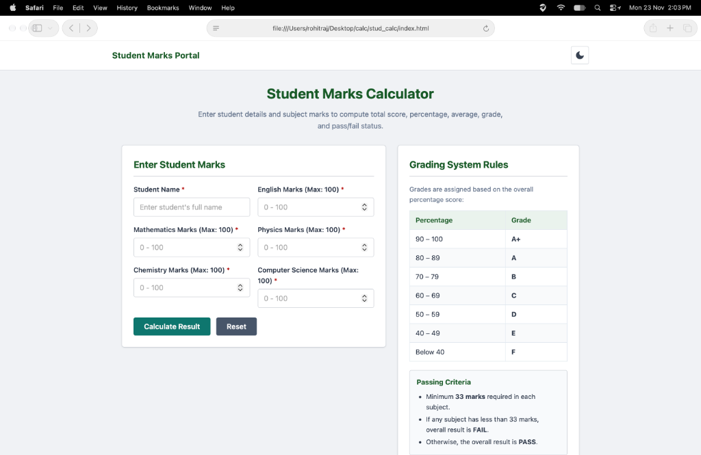
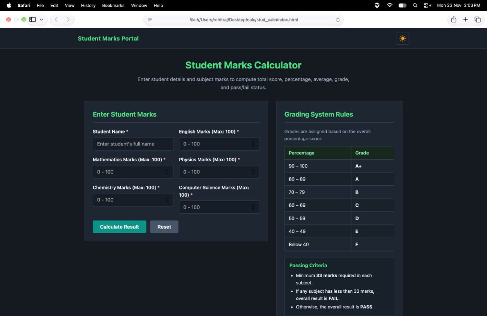
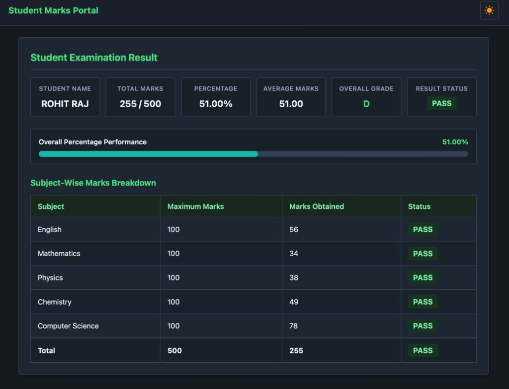
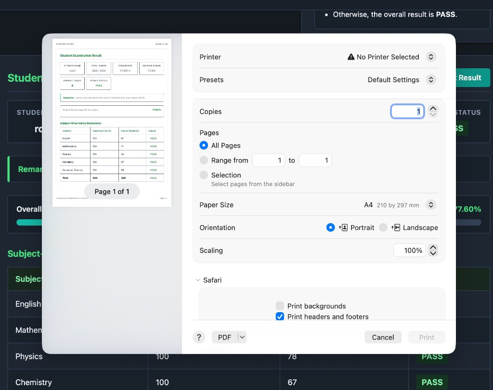

# Student Marks Calculator

A clean, responsive, and beginner-friendly **Student Marks Calculator** created using **HTML**, **CSS**, and **JavaScript**. This project is built as a first-year college practical submission to demonstrate DOM manipulation, form validation, conditional grading logic, responsive layouts, client-side theme switching, and printable examination reports.

The application works completely **offline** without any external libraries, CDNs, or frameworks.

---

## 📸 Screenshots & Interface Walkthrough

### 1. Light Mode (Default Interface)
*The default clean interface showing the 2-column input form alongside the grading rules table.*



<br>

### 2. Dark Mode (Theme Toggle)
*The high-contrast dark theme activated with a single click on the theme toggle button in the top-right corner.*



<br>

### 3. Student Examination Result Card & Performance Breakdown
*The comprehensive result section displayed upon submitting valid marks, featuring total score, percentage, average, grade, pass/fail status, performance remarks, visual progress bar, and subject-wise marks breakdown.*



<br>

### 4. Print & PDF Export Preview
*The clean, print-optimized examination report generated via the "Print Result" feature (configured with dedicated `@media print` CSS rules).*



---

## 🚀 Key Features

### 1. Student Information & Marks Input
- Clean input fields for:
  - **Student Name**
  - **English Marks** (Max: 100)
  - **Mathematics Marks** (Max: 100)
  - **Physics Marks** (Max: 100)
  - **Chemistry Marks** (Max: 100)
  - **Computer Science Marks** (Max: 100)
- Arranged neatly in two columns on desktop and a single column on mobile.
- Allows decimal marks (e.g., `78.50`).

### 2. Input Validation
- Ensures the student's name is not empty.
- Verifies that all 5 marks are provided and are valid numbers between `0` and `100`.
- Displays helpful error messages and highlights invalid input fields with red borders.

### 3. Automated Calculations
- **Total Marks**: Sum of marks across all 5 subjects out of 500.
- **Percentage**: Computed as `(Total Marks / 500) * 100`.
- **Average Marks**: Computed as `Total Marks / 5`.
- **Overall Grade**: Assigned according to the defined grading table.
- **Pass / Fail Status**: Evaluated based on subject-wise minimum passing marks.

---

## 📊 Grading Rules & Passing Criteria

The grading table and passing conditions are displayed on the webpage for reference:

| Percentage Range | Grade | Remarks |
|:---:|:---:|:---|
| **90% – 100%** | **A+** | Outstanding performance |
| **80% – 89%** | **A** | Excellent performance |
| **70% – 79%** | **B** | Good performance |
| **60% – 69%** | **C** | Satisfactory performance |
| **50% – 59%** | **D** | Average performance |
| **40% – 49%** | **E** | Passing performance |
| **Below 40%** | **F** | Failed |

### Passing Criteria:
- **Minimum 33 marks** are required in **each** individual subject.
- If **any** subject score is below 33 marks, the overall result status is **FAIL**.
- If all 5 subjects have 33 marks or higher, the overall result status is **PASS**.
- Overall grade is determined using the overall percentage score.

---

## 🎯 Enhancements & Interactive Components

1. **Light & Dark Theme Switcher**:
   - Small toggle button in the top-right corner with local SVG icons (`moon.svg` and `sun.svg`).
   - Uses CSS variables for instant theme switching.
   - Saves preferences in `localStorage` to persist across browser reloads.

2. **Subject-Wise Results Table**:
   - Detailed breakdown showing each subject, maximum marks (100), obtained marks, and individual **PASS** or **FAIL** status badges.

3. **Visual Percentage Progress Bar**:
   - Smooth animated progress bar illustrating the student's percentage score out of 100%.

4. **Performance Remarks**:
   - Contextual feedback tailored to the student's grade and pass/fail outcome.

5. **Print Results**:
   - Integrated **Print Result** button with dedicated `@media print` CSS styling for printing or saving as PDF.

6. **Reset Functionality**:
   - Clears all input fields, resets the progress bar, hides previous results, and refocuses the student name input.

---

## 📂 Project Structure

```
stud_calc/
│
├── index.html            # Main HTML structure
├── style.css             # Styles, CSS variables, themes & print media queries
├── script.js             # Form validation, calculations, DOM updates & theme logic
├── README.md             # Project documentation and screenshots
│
└── assets/
    ├── icons/
    │   ├── moon.svg      # Theme toggle moon icon (Light mode)
    │   └── sun.svg       # Theme toggle sun icon (Dark mode)
    └── images/
        ├── light-mode.png    # Screenshot of light theme
        ├── dark-mode.jpg     # Screenshot of dark theme
        ├── result-view.jpg   # Screenshot of examination results
        └── print-preview.jpg # Screenshot of print / PDF export preview
```

---

## 💻 How to Run the Project

1. Navigate to the `stud_calc` folder:
   ```bash
   cd stud_calc
   ```
2. Open `index.html` in any web browser (no local server or internet connection required):
   ```bash
   open index.html        # macOS
   # or
   xdg-open index.html    # Linux
   ```

---

## 🛠️ Technologies Used

- **HTML5**: Clean semantic markup.
- **CSS3**: CSS Custom Properties, Flexbox, Grid, Media Queries, Print Styles.
- **JavaScript**: Standard DOM manipulation and events without external dependencies.
